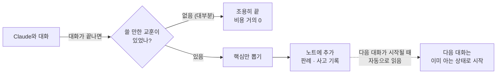
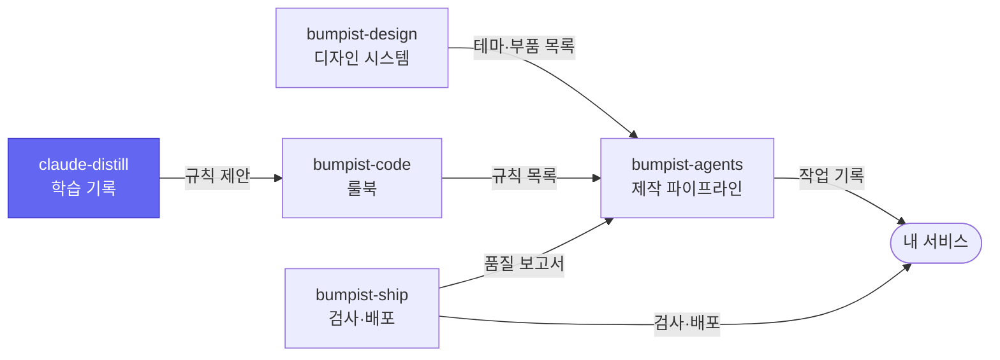

# claude-distill

**Claude가 대화에서 배운 것을 자동으로 인수인계 노트에 적어 두는 도구예요. 다음 대화의 Claude는 그 노트를 읽고 시작해요.**

Claude를 매일 새로 출근하는 사람이라고 생각해 보세요. 어제 가르친 요령을 오늘 또 설명해야 해요. claude-distill은 대화가 끝날 때마다 쓸 만한 교훈이 있었는지 보고, 있으면 노트에 적어요. 사용자가 할 일은 처음에 한 번 설치하는 것뿐이에요.

> **지금 상태 — npm v0.4.1.** 자동 기록, 비용을 줄이는 4단 필터, 한국어·영어 자동 기록까지 동작해요.

## 어떤 문제를 푸나요

```
설치 전
  첫 번째 대화   주의할 점 발견   →  "Claude야, 이거 조심해"
  두 번째 대화   같은 주의할 점   →  "Claude야, 이거 조심해"   (또?)
  세 번째 대화   같은 주의할 점   →  "Claude야, 이거 조심해"   (세 번째…)

설치 후 (claude-distill init 한 번)
  첫 번째 대화   주의할 점 발견   →  노트에 자동 기록
  두 번째 대화   Claude가 이미 알고 시작
  세 번째 대화   Claude가 이미 알고 시작
```

## 어떻게 동작하나요



노트는 두 개의 평범한 마크다운 파일이에요. 마음에 안 드는 내용은 그 줄을 지우면 돼요.

| 파일 | 비유 | 누가 쓰나 |
| --- | --- | --- |
| `CLAUDE.md` | 법률 — 변하지 않는 규칙 | 사람 |
| `knowledge.md` | 판례 — "이런 상황에선 이렇게 했다" | claude-distill이 자동으로 |
| `gotchas.md` | 사고 기록 — "같은 실수 반복 금지" | claude-distill이 자동으로 |

## 실제로 쌓인 기록

직접 쓰면서 자동으로 쌓인 항목들이에요(내용은 편집하지 않았어요).

```
gotcha     npm link가 macOS 기본 prefix에서 sudo 없이 실패 — 절대경로로 우회
gotcha     Claude Code JSONL의 promptId가 항상 null — uuid + parentUuid 체인 사용
gotcha     Cursor 빌트인 Claude는 PATH에 `claude` 바이너리를 노출 안 함
knowledge  ffmpeg cropdetect의 limit은 어두운 padding에서 ≥32 필요
knowledge  Transcript를 마지막 user marker부터 slice하면 분석 prompt ~80% 감소
knowledge  CSP `connect-src 'none'`이 webview의 외부 fetch를 이중 차단
```

항목마다 증상 → 함정 → 원인 → 우회 방법 순서로 정리돼요. 당연한 사실, 한 프로젝트 안에서만 의미 있는 내용, 확인되지 않은 추측은 기록하지 않아요.

## 써 보기

```bash
npm install -g claude-distill
claude-distill init
```

`init`은 두 가지를 등록해요. 여러 번 실행해도 결과는 같아요.

1. 대화가 끝날 때마다 분석을 부르는 Claude Code 설정(`~/.claude/settings.json`의 Stop hook)
2. 다음 대화부터 노트를 읽게 하는 참조 두 줄(`~/.claude/CLAUDE.md` 끝)

분석에 쓸 Claude 호출 방법이 하나 필요해요.

| 이런 분이라면 | 할 일 |
| --- | --- |
| 터미널에서 Claude Code를 써요 | 추가로 할 일 없어요. `claude` 명령을 그대로 써요 |
| Cursor · VS Code 확장으로 Claude Code를 써요 | `ANTHROPIC_API_KEY` 환경변수를 설정해요. 확장 안의 Claude는 외부에서 부를 수 없어서예요 |

결과는 `~/.claude/knowledge.md`와 `~/.claude/gotchas.md`를 열어서 보면 돼요. 따로 화면은 없어요.

## 비용이 거의 들지 않는 이유

대부분의 대화에는 기록할 교훈이 없다고 보고, 분석 전에 네 번 걸러요.

1. 다른 분석이 만든 대화면 바로 끝내요(무한 반복 방지).
2. 이미 분석한 구간이면 끝내요.
3. 짧거나, 도구를 쓰지 않았거나, 오류 흔적이 없는 대화면 끝내요(무료).
4. API 키가 있으면 Haiku에게 "기록할 게 있나?"만 한 단어로 물어요(사실상 0원).

이 네 번을 통과한 대화만 실제로 분석해요. 통과한 경우 Sonnet 기준 대화당 약 $0.10이에요.

## 개인정보와 보안

- **중간 서버가 없어요.** 내 컴퓨터에서 Anthropic API로 바로 가요. 이 도구의 제작자에게도 대화 내용이 가지 않아요.
- **API 키를 파일에 저장하지 않아요.** 환경변수로 넣은 값만 읽어요.
- **코드와 저장소는 건드리지 않아요.** 대화 기록은 읽기만 하고, 노트 파일 두 개에만 내용을 더해요.
- **분석 기록에는 내용이 아니라 짧은 지문만 남아요.** 같은 구간을 두 번 분석하지 않으려고 12자짜리 해시만 저장해요.
- 대화에 비밀번호나 키를 직접 적은 적이 있다면, 그 내용도 분석 요청에 포함될 수 있어요. 그런 대화는 분석 전에 `~/.claude/projects/` 안의 해당 기록 파일을 지우세요.

## 지금 되는 것과 아직 안 되는 것

| 상태 | 내용 |
| --- | --- |
| **지금 (v0.4.1)** | 자동 기록, 4단 필터, 한국어·영어 자동 감지, Claude Code CLI와 API 두 가지 호출 방법 |
| 준비 중 | 프로젝트별 노트(지금은 모든 프로젝트가 같은 노트를 써요. 코드 일부는 준비돼 있지만 아직 옵션으로 열지 않았어요) |
| 준비 중 | [bumpist-code](https://github.com/parksubeom/bumpist-code)로 보내는 규칙 제안 내보내기. 여러 프로젝트에서 반복된 함정을 룰북의 새 규칙 후보로 만들어요 |
| 계획 없음 | OpenAI나 로컬 모델 지원 |

## 이런 경우엔 맞지 않아요

- **회사 정책상 대화 내용을 외부 API로 보낼 수 없다면** 쓸 수 없어요. 분석에 Anthropic API를 써요.
- **노트에 자동으로 무언가 쌓이는 게 싫다면** 맞지 않아요. 확신도가 높은 항목만 남기지만, 사람이 검토하기 전에 기록돼요.

<details>
<summary><b>명령과 설정</b></summary>

| 명령 | 용도 |
| --- | --- |
| `claude-distill init` | 설치 후 한 번. Stop hook과 노트 참조를 등록해요 |
| `claude-distill where` | 파일 위치와 존재 여부 확인 |
| `claude-distill analyze` | 직접 분석. 보통은 자동으로 돌아서 쓸 일이 없어요 |

`analyze` 옵션: `--no-auto`(노트에 쓰지 않고 결과만 출력), `--mock`(가짜 항목 하나로 동작 확인), `--session=<파일>`, `--quiet`, `--lang=ko|en`, `--no-gate`·`--force`(필터를 건너뛰고 강제 분석)

| 환경변수 | 용도 |
| --- | --- |
| `ANTHROPIC_API_KEY` | API로 분석. 설정하면 Haiku 필터도 켜져요 |
| `CLAUDE_DISTILL_MODEL` | 분석 모델 (기본 `claude-sonnet-4-6`) |
| `CLAUDE_DISTILL_GATE_MODEL` | 필터 모델 (기본 `claude-haiku-4-5-20251001`) |
| `CLAUDE_DISTILL_LANG` | 기록 언어 고정 (`ko` 또는 `en`). 없으면 대화의 한글 비율로 정해요 |

기록되는 항목 종류는 11가지예요. 판례는 `trade_off_decision` `environment_quirk` `scale_transition` `tooling_insight` `performance_insight`, 사고 기록은 `api_quirk` `type_shape` `concurrency_race` `build_deploy` `privacy_security` `ux_regression`이에요.

</details>

<details>
<summary><b>멈추거나 지우려면</b></summary>

- **잠시 멈추기:** `~/.claude/settings.json`의 `hooks.Stop`에서 claude-distill 항목만 빼요.
- **완전히 지우기:** `npm uninstall -g claude-distill` 후 `~/.claude/CLAUDE.md` 끝의 `<!-- claude-distill auto-references -->` 블록을 지워요. 노트 두 개는 남기고 싶으면 그대로 두세요.
- **잘못 쌓인 항목:** 노트 파일에서 그 항목의 `###` 블록을 지우면 다음 대화부터 읽지 않아요.

</details>

## Bumpist Suite 안에서

다섯 저장소는 서로의 코드를 가져다 쓰지 않고, 정해진 형식의 파일만 주고받아요. 그래서 하나만 골라 써도 되고, 모두 연결해 쓸 수도 있어요. 색칠된 칸이 이 저장소예요.

| 저장소 | 한 줄 설명 |
| --- | --- |
| [bumpist-design](https://github.com/parksubeom/bumpist-design) | 서비스마다 색만 바꾸면 되는 디자인 시스템 |
| [bumpist-agents](https://github.com/parksubeom/bumpist-agents) | 아이디어에서 미리보기 링크까지 가는 Claude Code 작업 순서 |
| [bumpist-code](https://github.com/parksubeom/bumpist-code) | AI가 매번 같은 방식으로 코드를 쓰게 하는 룰북 |
| [bumpist-ship](https://github.com/parksubeom/bumpist-ship) | 파일 하나로 붙이는 자동 검사·배포 |
| [claude-distill](https://github.com/parksubeom/claude-distill) | Claude가 대화에서 배운 것을 자동으로 기록 |



claude-distill은 제품군과 따로 써도 완전히 동작해요. 연결하면, 대화에서 반복된 함정이 룰북의 새 규칙 후보가 되는 고리가 생겨요.

## 라이선스

MIT © parksubeom
